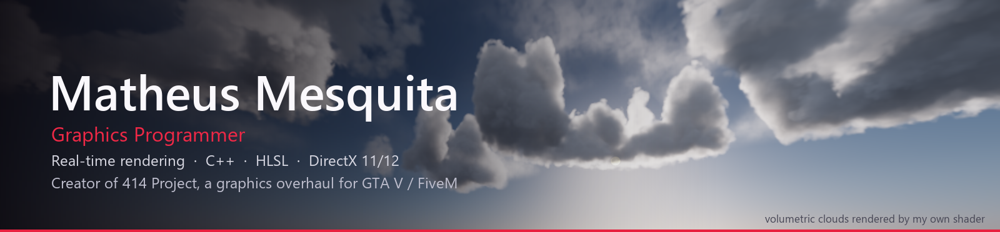

  

  
  
  

## About me

I'm a 23-year-old graphics programmer from Brazil 🇧🇷. I write real-time rendering code: shaders, render passes and the C++ plumbing that hooks them into a running game.

Most of my work goes into **[414 Project](https://414-project.com)**, a graphics overhaul for GTA V / FiveM that I build and ship to players. It started as shader edits and grew into a full rendering layer on top of a DirectX 11 game: volumetric clouds, a physically based sky, screen-space GI, custom bloom, water, depth of field and more, all running inside the game frame.

I'm open to work in rendering, engine and tools programming. 📫 **414labs@414-project.com**

## Volumetric clouds

My own raymarched cloud renderer, captured in **Toyota Shader Lab**, the standalone tool I wrote to develop shaders outside the game. Same HLSL that runs in-game, same weather data (the Lab reads the game's timecycle straight from its archive files).

<table>
  <tr>
    <td width="50%"></td>
    <td width="50%"></td>
  </tr>
  <tr>
    <td align="center">Afternoon to dusk: sun path, atmosphere and multiple scattering</td>
    <td align="center">Cloudy weather: shape, erosion and wind over time</td>
  </tr>
</table>

- Raymarched density field with Perlin-Worley base shape, Worley erosion and curl-noise detail
- Lighting with Henyey-Greenstein phase, multiple-scattering approximation, ambient from the sky and light bounced off the ground
- Weather-driven coverage map (clear cumulus, overcast decks, storm cells), wind shear and a 2D cirrocumulus layer
- Physically based atmosphere (transmittance, multi-scatter and sky-view LUTs) feeding sky color, fog and cloud ambient
- Baked cloud map plus empty-space skipping, which took the clouds from 142 ms to 27 ms per frame in the Lab

## Projects

| Project | What it is | Stack |
|---|---|---|
| **414 Project** (`Toyota.addon`) | Graphics overhaul for GTA V / FiveM, shipped to players. Replaces game shaders by hash and adds its own passes: volumetric clouds, physical sky, SSR, SSAO/SSIL/SSGI, FFT bloom, DOF, water, wet surfaces, car paint, skin. 800+ shader files, in-game settings panel, own shader loader. | C++, HLSL, D3D11, ReShade API, ImGui, CMake |
| **Toyota Shader Lab** | Standalone D3D11 app for building shaders outside the game: hot reload, offline batch rendering, HDR capture, GPU timing, and the game's real weather data loaded from its archives. | C++, HLSL, D3D11, Python |
| **ToyotaDLSS** | DLSS upscaling and frame generation for FiveM (in development), built on the public NVIDIA SDK: motion vectors, depth and camera data pulled from a game that never shipped with them. | C++, HLSL, D3D11/12, NGX |
| **ToyotaRT** | Ray-traced lighting experiment for the GTA V world, running D3D12 next to the game's D3D11 renderer. First phase proven in-game. | C++, HLSL, D3D12, DXR |
| **Toyota-Export** | Video export for the Rockstar Editor: high-quality capture through FFmpeg, plus changing the time and weather of a recorded clip. | C++, FFmpeg |
| **Toyota-Diretor** | AI scene director: a short request turns into a fully staged in-game scene. Native addon, Node.js server and a Discord bot for licensing. | C++, JavaScript, Node.js |
| **414 Project website** | The [414-project.com](https://414-project.com) site. | TypeScript, React, Vite, Tailwind |
| **Retrato Pronto** | AI portrait platform with Pix payments and delivery over WhatsApp or e-mail. | TypeScript |

Repositories are private. Happy to walk through the code in an interview.

## What I work with

**Languages**

  
  
  
  
  
  

**Graphics and engine**

  
  
  
  
  

**Tools and web**

  
  
  
  
  
  

**Rendering techniques I've shipped**

Volumetric raymarching · physically based atmosphere · screen-space reflections · SSAO / SSIL / SSGI · FFT bloom and lens flare · bokeh depth of field · GGX lighting · water and underwater rendering · procedural stars · shader replacement by bytecode hash · render-pass injection into a closed engine · GPU profiling

## Contact

- 🌐 [414-project.com](https://414-project.com)
- 📫 [414labs@414-project.com](mailto:414labs@414-project.com)
- 💬 [Discord](https://discord.gg/shadersmods)
